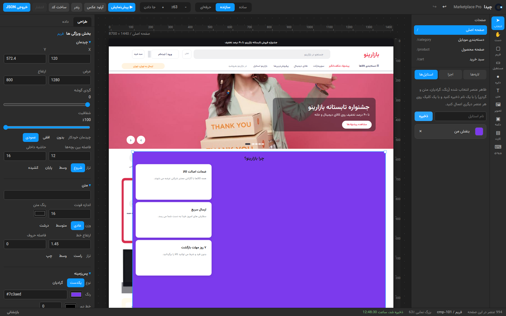
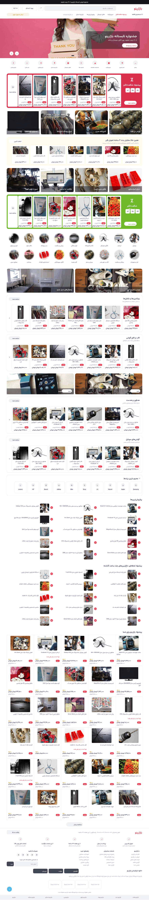
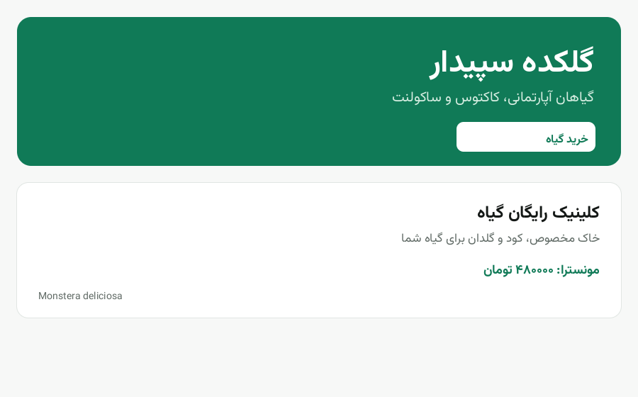
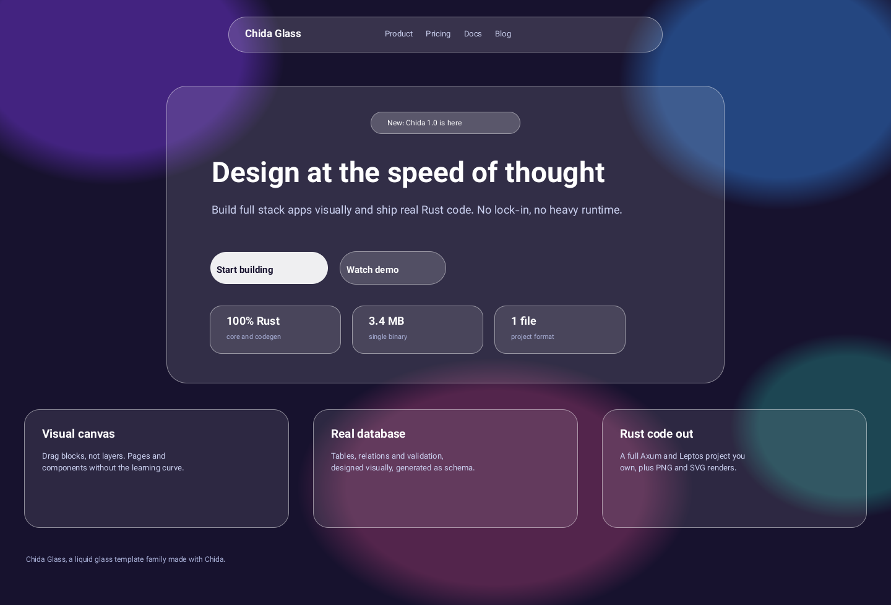
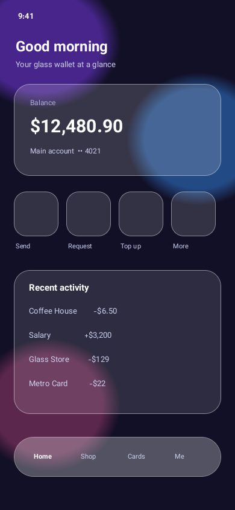
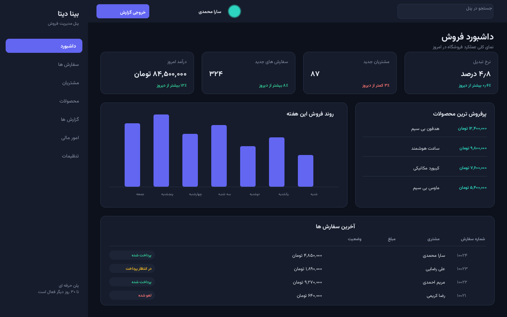
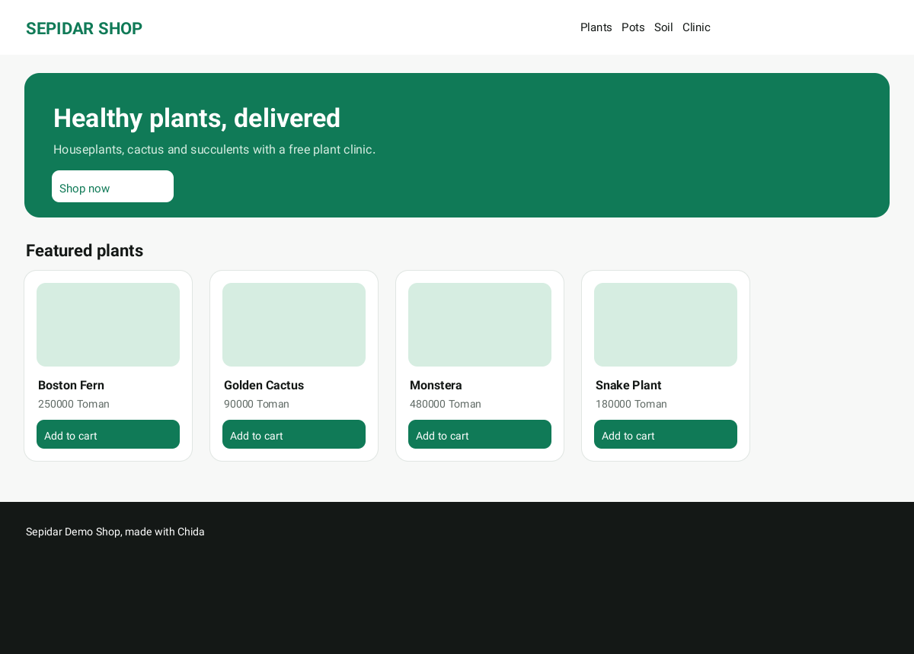

<p align="center">
  <a href="https://github.com/E30TZ/chida" target="_blank" rel="noopener noreferrer">
    <picture>
      <source media="(prefers-color-scheme: dark)" srcset="assets/logo/logo-horizontal-dark.svg">
      
    </picture>
  </a>
</p>

<h1 align="center">🧩 چیدا</h1>

<p align="center">
    <strong>تو صفحه را می‌کشی، چیدا از آن یک برنامهٔ واقعی می‌سازد.</strong>
</p>

---

<br/>
<p align="center">
    <a href="https://github.com/E30TZ/chida/actions/workflows/ci.yml" target="_blank">
        
    </a>
    <a href="https://github.com/E30TZ/chida/releases/latest" target="_blank">
        
    </a>
    <a href="https://github.com/E30TZ/chida/blob/main/LICENSE" target="_blank">
        
    </a>
    <a href="https://github.com/E30TZ/chida" target="_blank">
        
    </a>
</p>

<p align="center">
 <a href="./README.md">
 🇬🇧 English
 </a>
</p>

<p align="center">
  <a href="https://github.com/E30TZ/chida" target="_blank" rel="noopener noreferrer" >
    
  </a>
</p>

<p align="center"><i>این ویرایشگر است. سمت چپ و وسط می‌کشی. بقیهٔ این صفحه از دلِ همین‌جور نقاشی‌ها درمی‌آید.</i></p>

## 📋 فهرست

> **دسترسی سریع** - بپر به هر بخشی که می‌خواهی

-   [📖 چیدا چیه؟](#-چیدا-چیه)
-   [👀 خودت ببین](#-خودت-ببین)
-   [✨ چه کارهایی می‌توانی بکنی؟](#-چه-کارهایی-میتوانی-بکنی)
-   [🚀 همین حالا امتحانش کن](#-همین-حالا-امتحانش-کن)
-   [⚠️ چی هنوز آماده نیست؟](#-چی-هنوز-آماده-نیست)
-   [🛠️ برای برنامه‌نویس‌ها](#-برای-برنامهنویسها)
-   [📚 مستندات](#-مستندات)
-   [📄 مجوز](#-مجوز)

---

# 📖 چیدا چیه؟

> **یک قصه، همه چیز را می‌گوید**

فرض کن یک مغازهٔ کوچک روی اینترنت می‌خواهی. با چیدا سه کار می‌کنی:

**۱. صفحهٔ مغازه را می‌کشی.** یک تیتر بزرگ. عکس کالاها. زیر هر کدام قیمتش. جعبه‌ها را با موس می‌کشی و جابه‌جا می‌کنی، مثل یک برنامهٔ نقاشی.

**۲. می‌گویی کالا یعنی چی.** یک اسم، یک قیمت، یک عکس. سه کلمه که یک بار، در یک جدول ساده می‌نویسی.

**۳. یک دکمه را می‌زنی.** چیدا کل مغازه را تحویلت می‌دهد: همان صفحه‌هایی که کشیدی، یک برنامه که کالاها را نگه می‌دارد و سفارش می‌گیرد، و **همهٔ کدهایش**. کد مال توست. بازش کن، عوضش کن، خودت بگذارش روی اینترنت. هیچ چیز داخل چیدا قفل نمی‌ماند.

چیدا همین است. یک برنامهٔ نقاشی که نقاشی‌هایش برنامهٔ واقعی می‌شوند. با Rust نوشته شده، سریع و سبک است، و متن فارسی و عربی در همهٔ نتیجه‌ها راست‌به‌چپ و درست درمی‌آید.

---

# 👀 خودت ببین

> **حرف ما را قبول نکن. نگاه کن.**

همهٔ عکس‌های اینجا واقعی‌اند. چیدا هر کدام را از یک پروژهٔ آماده، با یک دستور کشیده است. هیچ کدام نقاشی تبلیغاتی نیست. دستور هر عکس زیرش نوشته شده تا خودت هم همان عکس را بسازی.

**یک مغازهٔ بزرگ فارسی، راست‌به‌چپ** · `chida new shop2 --template digikala`



**یک صفحهٔ فارسی، ساده و تمیز** · `chida new fa --template persian`



**یک صفحه که مثل شیشهٔ مات است** · `chida new glassy --template liquid-glass`



**همان صفحه، روی گوشی**



**یک پنل برای صاحب مغازه** · `chida new panel --template saas-dashboard`



**یک مغازهٔ کوچک** · `chida new demo`



---

# ✨ چه کارهایی می‌توانی بکنی؟

> **چهار چیز، هر کدام با کلمه‌های ساده**

<div align="right">

**🎨 صفحه‌هایی بکش که واقعی به نظر می‌رسند**
- صفحه‌ها، لایه‌ها، خط‌کش و راهنمای چسبان، مثل یک ابزار طراحی واقعی
- کشیدن، تغییر اندازه، انتخاب چند چیز با هم، انتخاب با کشیدن کادر
- جعبه‌ها خودشان در ردیف و ستون می‌نشینند (چیدمان خودکار)
- یک ظاهر را یک بار ذخیره کن و همه جا استفاده‌اش کن (استایل‌های نامی)
- عکس‌های خودت را بیاور داخل
- پیش‌نمایش را بزن و دور صفحه کلیک کن: لینک صفحه‌ها واقعاً کار می‌کنند
- با حالت **ساده** و دکمه‌های بزرگ شروع کن. **سازنده** و بعد **حرفه‌ای** را فقط وقتی باز کن که خواستی. سطح آخر حتی کد را هم نشان می‌دهد

**📄 یک نقاشی را به برنامهٔ در حال کار تبدیل کن**
- با یک فشار، از هر صفحه یک **عکس PNG** یا یک **فایل SVG** بگیر
- یک دستور، **کل برنامه** را می‌نویسد: برنامهٔ پشت صفحه‌ها، صفحه‌هایی که مردم می‌بینند، نقشهٔ دیتابیس و نقشهٔ API
- برنامه‌هایی که چیدا می‌نویسد، **ساخته و اجرا می‌شوند**. بک‌اندشان واقعاً روشن و تست شده است

**🗂️ لیست نگه دار و قانون بساز، بدون کد**
- مغازه‌ات کالا نگه می‌دارد، درمانگاهت بیمار: هر لیست یک جدول است و ستون‌هایش را تو انتخاب می‌کنی (اسم = متن، قیمت = عدد و بقیه)
- قانون‌ها جعبه‌هایی هستند که به هم وصل می‌کنی: *اگر این شد، بعد آن کار را بکن*
- یک قانون می‌تواند یک صفحه را باز کند، یک پیام نشان بدهد، یک ردیف را ذخیره یا پاک کند، یا یک برنامهٔ دیگر را صدا بزند

**🌍 فارسی و عربی را درست بنویس**
- حرف‌ها درست به هم می‌چسبند و شکل می‌گیرند، متن راست‌به‌چپ می‌رود، در عکس و SVG و صفحهٔ وب
- فونت **وزیرمتن** داخل خود چیدا است
- در یک خطِ مخلوط، عدد و کلمهٔ انگلیسی سر جای درست خودشان می‌مانند

</div>

هر پروژه از یک شروع آماده آغاز می‌شود تا هیچ وقت با صفحهٔ خالی روبه‌رو نشوی: **shop**، **digikala** (همان مغازهٔ بزرگ فارسی بالا)، **persian**، **liquid-glass** (همان صفحهٔ شیشه‌ای بالا)، **saas-dashboard**، **clinic**، **restaurant**، **portfolio**، **blank**.

---

# 🚀 همین حالا امتحانش کن

> **سه قدم. بدون حساب کاربری. بدون پرداخت.**

### قدم ۱: فایل کامپیوترت را بردار

همهٔ فایل‌ها در یک صفحه‌اند: [صفحهٔ دانلود](https://github.com/E30TZ/chida/releases/latest). مال خودت را انتخاب کن:

| کامپیوترت | این فایل را بردار | بعدش چی؟ |
| --- | --- | --- |
| ویندوز | `chida-1.0.1-windows-x86_64.zip` | بازش کن، `chida.exe` را اجرا کن |
| مک با Apple Silicon | `chida-1.0.1-macos-aarch64.tar.gz` | بازش کن، `chida` را اجرا کن |
| مک با اینتل | `chida-1.0.1-macos-x86_64.tar.gz` | بازش کن، `chida` را اجرا کن |
| لینوکس، هر توزیعی | `chida-1.0.1-linux-x86_64.tar.gz` | بازش کن، `chida` را اجرا کن. نیازی به نصب نیست |
| لینوکس، فقط یک فایل | `chida-1.0.1-linux-x86_64.AppImage` | اجراپذیرش کن و دوبار کلیک کن |
| دبیان یا اوبونتو | `chida_1.0.1_amd64.deb` | مثل هر برنامه‌ای نصبش کن |
| فدورا یا RHEL | `chida-1.0.1-1.fc45.x86_64.rpm` | مثل هر برنامه‌ای نصبش کن |
| لینوکس روی ARM64 | `chida-1.0.1-linux-aarch64.tar.gz` | بازش کن، `chida` را اجرا کن |
| فقط ویرایشگر، در مرورگر | `chida-editor-1.0.1.zip` | بازش کن و در مرورگر اجراش کن (یادداشت پایین) |

فایل `SHA256SUMS` در همان صفحه برای این است که مطمئن شوی دانلودت کامل رسیده است. نصب‌کننده‌های دسکتاپ (ویرایشگر در پنجرهٔ خودش، بدون ترمینال) در حال ساخته شدن‌اند و به همین صفحه اضافه می‌شوند.

### قدم ۲: دو خط را کپی کن

در پوشه‌ای که چیدا را گذاشتی، ترمینال را باز کن و این دو خط را یکی‌یکی بچسبان:

```bash
./chida new myshop --template shop
./chida render myshop/myshop.chida.json --out myshop-pictures
```

خط اول یک پروژهٔ مغازهٔ کوچک می‌سازد. خط دوم صفحه‌هایش را به‌صورت عکس می‌کشد.

### 📋 قدم ۳: ببین چی گرفتی

<div align="right">

**🖼️ پوشهٔ** `myshop-pictures` **را باز کن.** عکس‌های داخلش مغازهٔ توست که چیدا کشیده. کل ایده همین است، همین حالا در دست تو.

**✏️ دوست داری کلیک کنی، نه تایپ؟** فایل `chida-editor-1.0.1.zip` را باز کن و ویرایشگر را در مرورگرت اجرا کن. اگر صفحه سفید ماند، پوشه را با یک وب‌سرور محلی کوچک اجرا کن: مرورگرها ویرایشگر را مستقیم از روی فایل باز نمی‌کنند.

**🗂️ کل پروژه یک فایل است:** `myshop/myshop.chida.json` صفحه‌ها، جدول‌ها و قانون‌ها را نگه می‌دارد. جابه‌جاش کن، کپی‌اش کن، برای دوستت بفرستش.

</div>

### 🔧 قدم بعدی: خود برنامه را بگیر

```bash
# همهٔ شروع‌های آماده را ببین
./chida templates

# کل برنامه را بگیر، با همهٔ کدهایش
./chida generate myshop/myshop.chida.json --out myshop-app
```

---

# ⚠️ چی هنوز آماده نیست؟

> **راستش را می‌گوییم، قبل از این که خودت به سختی بفهمی**

<div align="right">

-   برنامه‌ای که چیدا برایت می‌سازد، لیست‌هایش را در حافظه نگه می‌دارد. وقتی برنامه بایستد، لیست‌ها دوباره از داده‌های اول شروع می‌شوند. ذخیره کردن در دیتابیس واقعی، کار بزرگ بعدی است.
-   پسوردها در برنامه‌های ساخته‌شده فعلاً با یک روش ساده قفل می‌شوند و خود کد هم این را باز و روشن نوشته است. فعلاً برای پسورد واقعی آدم‌ها از آن استفاده نکن.
-   متن‌های خیلی طولانی که فارسی و انگلیسی را در یک کادر قاطی کنند، ممکن است کمی بی‌نظم دربیایند. تیتر و قیمت و خط‌های معمولی درست‌اند.
-   پنجرهٔ دسکتاپ کار می‌کند ولی تازه است؛ نصب‌کننده‌های آماده‌اش هنوز در حال ساخته شدن‌اند.

</div>

---

# 🛠️ برای برنامه‌نویس‌ها

خود چیدا یک ورک‌اسپیس Rust است. هر پروژه یک فایل JSON است (`name.chida.json`). رندرر متن را با HarfBuzz (rustybuzz) شکل می‌دهد و با fontdue می‌کشد. برنامه‌ای که چیدا برایت می‌نویسد، یک بک‌اند Axum است با یک دست روت CRUD برای هر جدول به‌همراه ثبت‌نام و ورود، یک فرانت‌اند Leptos با یک کامپوننت برای هر صفحه، اسکیمای SQL، یک فایل OpenAPI 3، یک پیش‌نمایش HTML ساده، یک Dockerfile و یک یونیت systemd.

```bash
cargo build --release   # ساخت خود چیدا
cargo test              # ۷۳ تست
```

```text
crates/chida-core     صفحه‌ها، عنصرها، فایل پروژه، تاریخچهٔ برگشت
crates/chida-render   کشیدن PNG و SVG
crates/chida-db       جدول‌ها، قانون‌ها، نوشتن SQL
crates/chida-logic    موتور جریان‌ها (اگر این شد، آن کار را بکن)
crates/chida-codegen  کل برنامه را برایت می‌نویسد
crates/chida-cli      دستور chida
apps/editor           همان ویرایشگری که در عکس بالا می‌بینی (Leptos و WebAssembly)
apps/desktop          ویرایشگر در پنجرهٔ دسکتاپ (Tauri 2)
templates             شروع‌های آماده
```

---

# 📚 مستندات

<div align="right">

**📖 این صفحه به زبان‌های دیگر:**

🇬🇧 **[English](./README.md)**

**📂 بیشتر در همین ریپو:**

-   [تغییرات](./CHANGELOG.md) - در هر نسخه چه عوض شده است
-   [مشارکت](./CONTRIBUTING.md) - چطور کمک کنی
-   [قالب‌ها](./templates/README.md) - همهٔ شروع‌های آماده با جزئیات
-   [اپ دسکتاپ](./apps/desktop/README.md) - پنجرهٔ دسکتاپ را خودت بساز

</div>

---

# 📄 مجوز

MIT. ببین [LICENSE](./LICENSE). می‌توانی چیدا را رایگان استفاده کنی، حتی برای کار پولی.

فونت وزیرمتن که همراه چیدا می‌آید، تحت مجوز SIL Open Font License 1.1 است. DejaVu Sans فونت پشتیبان است.

---

<p align="center">
  ساخته‌شده با ❤️ و Rust
</p>
