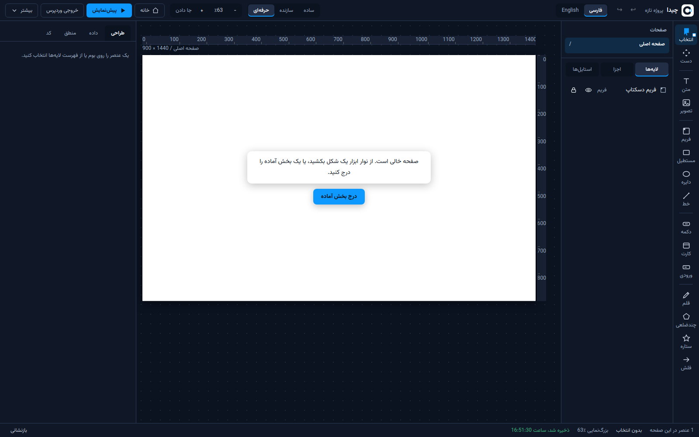
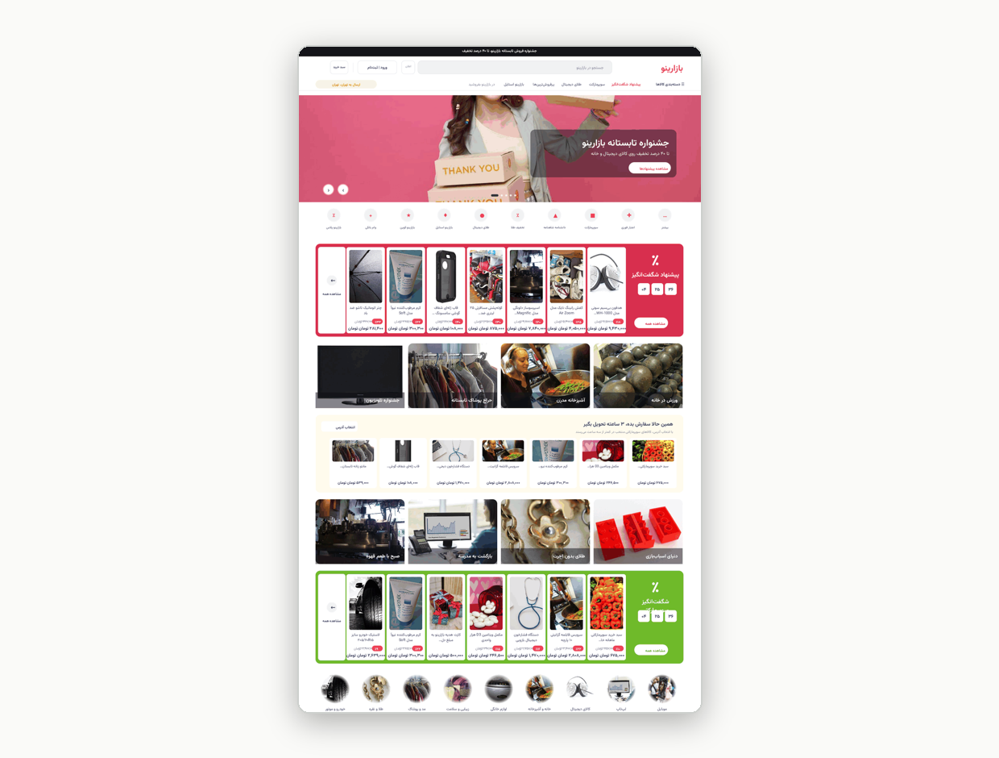
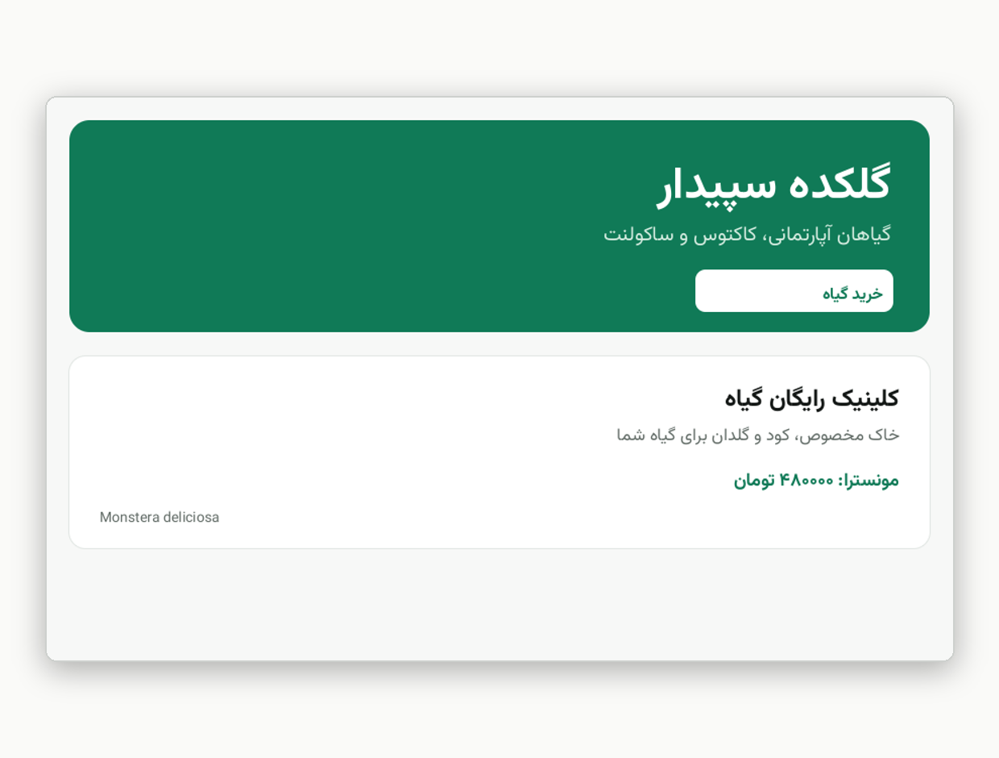
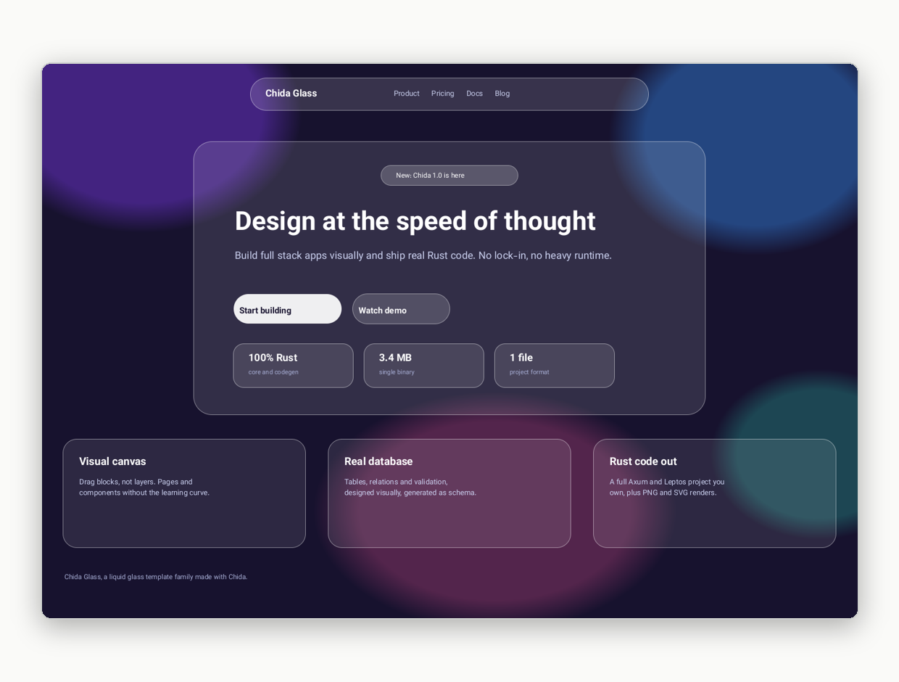
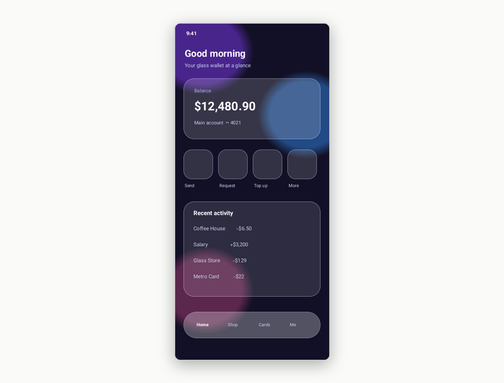
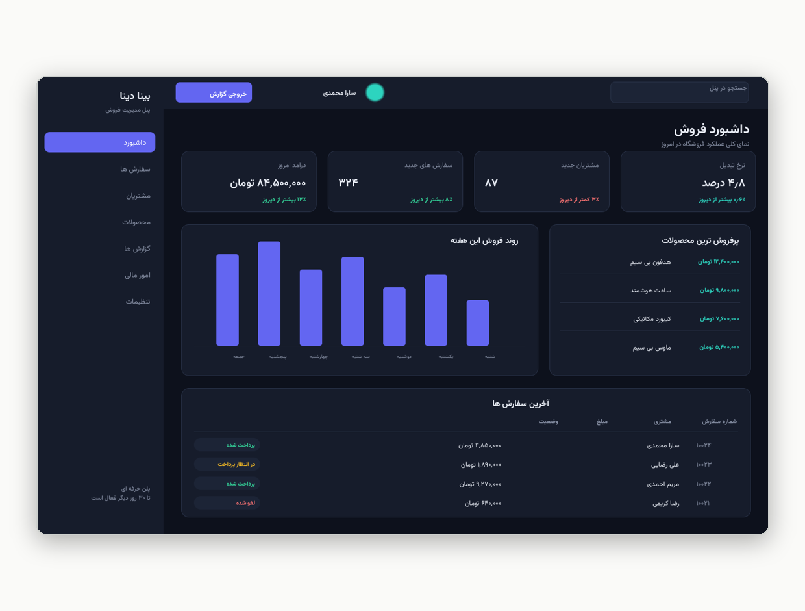
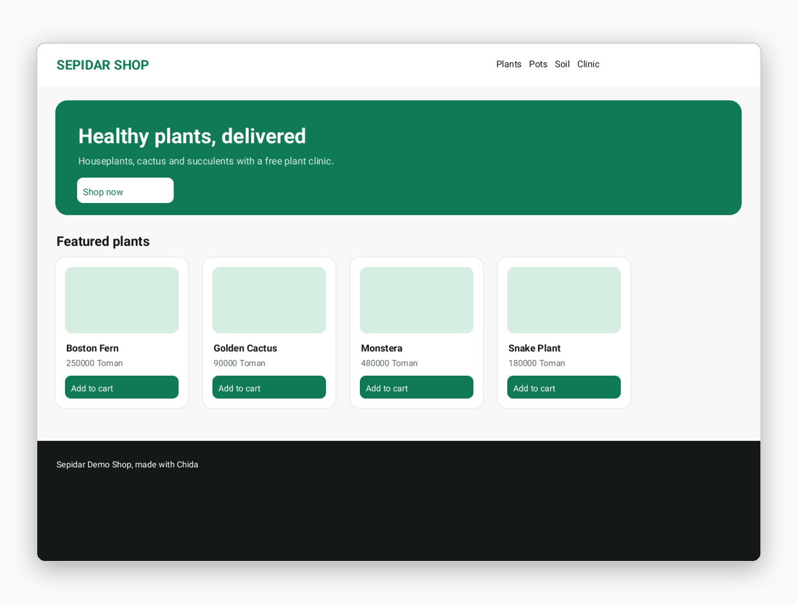

<p align="center">
  <a href="https://github.com/E30TZ/chida" target="_blank" rel="noopener noreferrer">
    <picture>
      <source media="(prefers-color-scheme: dark)" srcset="assets/logo/logo-horizontal-dark.svg">
      
    </picture>
  </a>
</p>

<h1 align="center">🧩 Chida</h1>

<p align="center">
    <strong>You draw a page. Chida turns it into a real app.</strong>
</p>

---

<br/>
<p align="center">
    <a href="https://github.com/E30TZ/chida/actions/workflows/ci.yml" target="_blank">
        
    </a>
    <a href="https://github.com/E30TZ/chida/releases/latest" target="_blank">
        
    </a>
    <a href="https://github.com/E30TZ/chida/blob/main/LICENSE" target="_blank">
        
    </a>
    <a href="https://github.com/E30TZ/chida" target="_blank">
        
    </a>
</p>

<p align="center">
 <a href="./README.fa.md">
 🇮🇷 فارسی
 </a>
</p>

<p align="center">
  <a href="https://github.com/E30TZ/chida" target="_blank" rel="noopener noreferrer" >
    
  </a>
</p>

<p align="center"><i>This is the editor itself. You draw here; Chida builds the rest.</i></p>

## 📋 Table of Contents

> **Quick Navigation** - Jump to any section below

-   [📖 What is Chida?](#-what-is-chida)
-   [👀 See it](#-see-it)
-   [✨ What you can do](#-what-you-can-do)
-   [🚀 Try it now](#-try-it-now)
-   [⚠️ What is not ready yet](#-what-is-not-ready-yet)
-   [🛠️ For developers](#-for-developers)
-   [📚 Documentation](#-documentation)
-   [📄 License](#-license)

---

# 📖 What is Chida?

> **One story tells you everything**

Say you want a small shop on the internet. With Chida you do three things:

**1. You draw the shop page.** A big title. Pictures of the products. A price under each one. You drag boxes with the mouse, like in a drawing program.

**2. You say what a product is.** A name, a price, a photo. Three words you type once, in a simple table.

**3. You press one button.** Chida hands you back the whole shop: the pages you drew, a program that keeps the products and takes orders, and **all of its code**. The code is yours. Open it, change it, put it on the internet yourself. Nothing stays locked inside Chida.

That is Chida. A drawing program whose drawings become real apps. It is written in Rust, it is fast and light, and Persian and Arabic text comes out right-to-left and correct in every result.

---

# 👀 See it

> **Do not take our word for it. Look.**

Every picture here is real. Chida drew each one from a ready-made project with a single command. None of them is a painting made for this page. The command is written under each picture, so you can make the same picture yourself.

|  |  |
| :---: | :---: |
|  |  |
| **A big Persian shop, reading right to left** | **A Persian page, simple and clean** |
| `chida new shop2 --template digikala` | `chida new fa --template persian` |
|  |  |
| **A page that looks like frosted glass** | **The same page, on a phone** |
| `chida new glassy --template liquid-glass` |  |
|  |  |
| **A control panel for the shop owner** | **A small shop** |
| `chida new panel --template saas-dashboard` | `chida new demo` |

---

# ✨ What you can do

> **Four things, each in plain words**

<div align="left">

**🎨 Draw pages that look real**
- Pages, layers, rulers and snap guides, like a real design tool
- Drag, resize, pick many things at once, draw a box to select
- Boxes line themselves up in rows and columns (auto layout)
- Save a look once and reuse it everywhere (named styles)
- Bring your own pictures in
- Press preview and click around: the page links really work
- Start in **Simple** mode with big buttons. Open **Builder**, then **Pro**, only when you want more. The last level shows even the code

**📄 Turn a drawing into a working app**
- One press gives you a **PNG picture** or an **SVG file** of any page
- One command writes the **whole app**: the program behind the pages, the screens people see, the database plan and the API plan
- The apps Chida writes **build and run**. Their backends were started and tested for real

**🗂️ Keep lists and make rules, without code**
- Your shop keeps products, your clinic keeps patients: every list is a table, and you choose its columns (name = text, price = number, and so on)
- Rules are boxes you connect: *if this happens, then do that*
- A rule can open a page, show a message, save or delete a row, or call another program

**🌍 Type Persian and Arabic the right way**
- Letters join and shape correctly, text runs right-to-left, in pictures, in SVG and in web pages
- The **Vazirmatn** font comes inside Chida
- In a mixed line, numbers and English words stay in the right order

</div>

Every project starts from a ready-made one, so you never face an empty page: **shop**, **digikala** (the big Persian shop above), **persian**, **liquid-glass** (the glass page above), **saas-dashboard**, **clinic**, **restaurant**, **portfolio**, **blank**.

---

# 🚀 Try it now

> **Three steps. No account. No payment.**

### Step 1: take the file for your computer

All files live on one page: the [download page](https://github.com/E30TZ/chida/releases/latest). Pick yours:

| Your computer | Take this file | Then what |
| --- | --- | --- |
| Windows | `chida-1.0.1-windows-x86_64.zip` | Unzip it, run `chida.exe` |
| Mac with Apple Silicon | `chida-1.0.1-macos-aarch64.tar.gz` | Unzip it, run `chida` |
| Mac with Intel | `chida-1.0.1-macos-x86_64.tar.gz` | Unzip it, run `chida` |
| Linux, any distro | `chida-1.0.1-linux-x86_64.tar.gz` | Unzip it, run `chida`. No install |
| Linux, one single file | `chida-1.0.1-linux-x86_64.AppImage` | Make it executable, double-click |
| Debian or Ubuntu | `chida_1.0.1_amd64.deb` | Install it like any program |
| Fedora or RHEL | `chida-1.0.1-1.fc45.x86_64.rpm` | Install it like any program |
| Linux on ARM64 | `chida-1.0.1-linux-aarch64.tar.gz` | Unzip it, run `chida` |
| Only the editor, in a browser | `chida-editor-1.0.1.zip` | Unzip it, open it (note below) |

The `SHA256SUMS` file on the same page lets you check your download arrived whole. Desktop installers (the editor in its own window, no terminal) are being built now and will be added to the same page.

### Step 2: copy two lines

Open a terminal in the folder where you put Chida and paste these two lines, one at a time:

```bash
./chida new myshop --template shop
./chida render myshop/myshop.chida.json --out myshop-pictures
```

The first line makes a small shop project. The second line draws its pages as pictures.

### 📋 Step 3: look at what you got

<div align="left">

**🖼️ Open the folder** `myshop-pictures`. The pictures inside are your shop, drawn by Chida. That is the whole idea, working in your hands.

**✏️ You would rather click than type?** Unzip `chida-editor-1.0.1.zip` and open the editor in your browser. If the page stays white, serve the folder with any small local web server: browsers do not load the editor straight from a file.

**🗂️ One file is the whole project:** `myshop/myshop.chida.json` holds the pages, the tables and the rules. Move it, copy it, send it to a friend.

</div>

### 🔧 Next: get the app itself

```bash
# See every ready-made starting point
./chida templates

# Get the whole app, with all its code
./chida generate myshop/myshop.chida.json --out myshop-app
```

---

# ⚠️ What is not ready yet

> **We say it plainly, before you find out the hard way**

<div align="left">

-   The app Chida makes for you keeps its lists in memory. When the app stops, the lists start again from the seed data. Saving to a real database is the next big job.
-   Passwords in the apps Chida makes are locked with a simple method for now, and the code says so itself, in the open. Do not use it for real people's passwords yet.
-   Very long texts that mix Persian and English in one box can come out in a slightly wrong order. Titles, prices and normal lines are fine.
-   The desktop window works but is new; its ready installers are still being built.

</div>

---

# 🛠️ For developers

Chida itself is a Rust workspace. A project is one JSON file (`name.chida.json`). The renderer shapes text with HarfBuzz (rustybuzz) and rasterises with fontdue. The app Chida writes for you is an Axum backend with one CRUD route set per table plus sign-up and login, a Leptos frontend with one component per page, the SQL schema, an OpenAPI 3 file, a static HTML preview, a Dockerfile and a systemd unit.

```bash
cargo build --release   # build Chida itself
cargo test              # 73 tests
```

```text
crates/chida-core     pages, elements, project files, undo history
crates/chida-render   PNG and SVG drawing
crates/chida-db       tables, rules, SQL writing
crates/chida-logic    the flow engine (if this, then that)
crates/chida-codegen  writes the whole app for you
crates/chida-cli      the chida command
apps/editor           the editor in the picture above (Leptos, WebAssembly)
apps/desktop          the editor in a desktop window (Tauri 2)
templates             the ready-made starting points
```

---

# 📚 Documentation

<div align="left">

**📖 This page in other languages:**

🇮🇷 **[فارسی](./README.fa.md)**

**📂 More in this repo:**

-   [Changelog](./CHANGELOG.md) - what changed in each version
-   [Contributing](./CONTRIBUTING.md) - how to help
-   [Templates](./templates/README.md) - every starting point in detail
-   [Desktop app](./apps/desktop/README.md) - build the desktop window yourself

</div>

---

# 📄 License

MIT. See [LICENSE](./LICENSE). You can use Chida for free, also for paid work.

The Vazirmatn font that ships with Chida is under the SIL Open Font License 1.1. DejaVu Sans is the backup font.

---

<p align="center">
  Made with ❤️ and Rust
</p>
